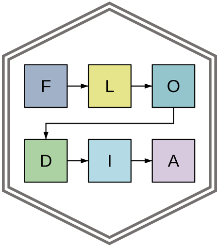

# flodia 
<!-- badges: start -->
[](https://www.repostatus.org/#concept)
[](https://github.com/mrc-ide/flodia/actions)
[](https://codecov.io/gh/mrc-ide/gonovax)
[](https://www.codefactor.io/repository/github/mrc-ide/flodia)
<!-- badges: end -->

`flodia` provides tools for drawing compartmental model flow diagrams in base R.

## Installation

The package can be installed directly from GitHub with:

```r
remotes::install_github("mrc-ide/flodia", upgrade = FALSE)
```

## License

MIT © Imperial College of Science, Technology and Medicine

## Examples

### COVID-19 multistrain with vaccination
Sonabend R, Whittles LK, Imai N et al. Non-pharmaceutical interventions, vaccination, and the SARS-CoV-2 delta variant in England: a mathematical modelling study. The Lancet, 2021; 398, 1825-1835. [10.1016/S0140-6736(21)02276-5](https://doi.org/10.1016/S0140-6736(21)02276-5)


### COVID-19 with age structure
Knock E, Whittles LK, Lees J et al. The 2020 SARS-CoV-2 epidemic in England: key epidemiological drivers and impact of interventions. Science Translational Medicine, 2021; 13(602). [10.1126/scitranslmed.abg4262](https://doi.org/10.1126/scitranslmed.abg4262) 

R package: [https://mrc-ide.github.io/sircovid/](https://mrc-ide.github.io/sircovid/)


### Gonorrhoea with activity-structure and vaccination 
Whittles LK, Didelot X, White PJ. Public health impact and cost-effectiveness of gonorrhoea vaccination: an integrated transmission-dynamic health-economic modelling analysis. The Lancet Infectious Diseases, 2022; 22(7), 1030-1041. [10.1016/S1473-3099(21)00744-1](https://doi.org/10.1016/S1473-3099(21)00744-1)


